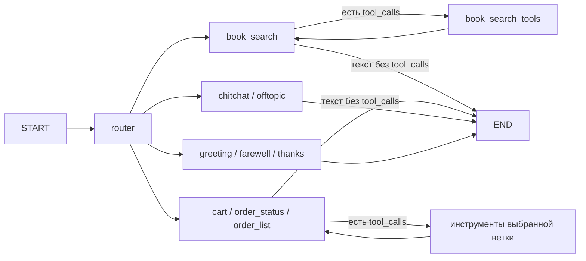

# ИИ-ассистент магазина

## Возможности

Авторизованный покупатель может общаться с консультантом в виджете магазина: описать желаемую книгу обычными словами, уточнить автора, название, категорию, бюджет и рейтинг, посмотреть корзину, добавить книгу и узнать сведения о своих заказах. Продолжение вроде «покажи ещё» учитывает недавний диалог.

| Запрос покупателя | Что поддерживает реализация |
| --- | --- |
| «Хочу что-нибудь про космос и одиночество» | Семантический поиск по смыслу описания: настроение, тема, сюжет. Инструмент возвращает до 5 доступных книг и исключает ранее найденные им книги по ID и сочетанию названия с автором. |
| «Книги Марии Север от 10 до 25 евро, рейтинг от 4» | Поиск в PostgreSQL по частям названия и имени автора, названию или slug категории, включительным границам цены и минимальному рейтингу. Инструмент возвращает до 10 доступных книг. |
| «Что в корзине?», «Добавь книгу 101» | Просмотр позиций, количества, цен и суммы; добавление одного экземпляра по ID. По названию ассистент сначала может найти ID. |
| «Покажи заказ №25», «Что с последним заказом?» | Один собственный заказ по номеру или собственный заказ с максимальным ID, если номер не указан. |
| «Покажи оплаченные заказы» | Собственные заказы от новых к старым, с необязательным фильтром статуса. По умолчанию до 10, через параметры инструмента — от 1 до 50. |
| Приветствие, благодарность, прощание | Готовый ответ из кода. Простые фразы распознаются до обращения к модели; оставшиеся может распознать классификатор. |
| «Кто ты?», неясное сообщение или посторонняя тема | Короткий ответ небольшой модели без инструментов. Для неясного запроса ей поручено уточнить пожелания, для посторонней темы — предложить вернуться к книгам и заказам. |

**Границы гарантий:** запрет повторов реализован в семантическом инструменте, но не в поиске по фильтрам и не при выдаче готового ответа из кэша. Совместный запрос по смыслу, цене и рейтингу не превращается в единый строгий запрос к хранилищу: сопоставление результатов двух инструментов поручено модели. Формулировки ответа и выбор инструментов зависят от модели; ограничения доступа к заказам проверяет сервер.

## Сквозной сценарий (E2E)

Анна уже вошла как покупатель с `user_id=42`. Она открывает консультанта, выбирает книгу, добавляет её в корзину и проверяет прежние заказы. Разговор идёт без превышения лимитов. Книги, цены, ID, оценки сходства и заказы ниже **условные**: это данные для объяснения прохождения кода, а не содержимое работающего магазина. Решения модели показаны как один допустимый ход выполнения, а не как гарантированный ответ на каждую фразу.

Памятка проверена по [коммиту `e281be0` репозитория FastAPI Bookshop](https://github.com/luciuseneca/fastapi-bookshop/tree/e281be01f267ee0a3215f61e1cf6312b33434ba6). Адреса сервисов и названия моделей далее соответствуют `.env.example`; действующее окружение может их переопределить.

### 1. Анна открывает виджет и пишет «Привет!»

JavaScript создаёт на странице плавающий виджет с вкладкой «Консультант». При открытии `ensureAuth()` проверяет наличие access-токена через `getToken()` или пытается получить его через `refreshAccessToken()`. Без авторизации виджет показывает ссылку на вход и отключает ввод. На странице `/auth` и в панели менеджера виджет вообще не создаётся.

Анна отправляет «Привет!». `agentSend()` убирает крайние пробелы, добавляет её сообщение в интерфейс, очищает поле, блокирует кнопку отправки и показывает «думает…». Функция `streamChat(message, onEvent, _retry=true)` выполняет запрос:

```http
POST /api/agent/chat
Authorization: Bearer <access-токен Анны>
Content-Type: application/json

{"message":"Привет!"}
```

Префикс `/api` берётся из настроек приложения, `/agent/chat` — из маршрута ассистента. `body` (модель Pydantic `AgentChatREQT`) содержит только `message`: строку длиной от 1 до 10 000 символов. В виджете HTML-поле имеет `maxlength=2000`, но это отдельное клиентское ограничение.

Зависимость `auth_client` проверяет access-JWT и роль `authorized_user`. `CustomerAuthorizedREQT` (модель Pydantic с данными авторизации) получает `sub=42` из токена. Сервер вызывает `service.stream_chat(user_id=user.sub, message=body.message)`, то есть `stream_chat(user_id=42, message="Привет!")`, и оборачивает асинхронный генератор в `EventSourceResponse` из `sse-starlette`.

**ID пользователя не выбирает модель и не присылает тело запроса.** Он попадает из проверенного токена в замыкания инструментов, поэтому просьба «покажи заказы пользователя 99» не меняет владельца SQL-запроса. На этом маршруте проверяется JWT, отдельного чтения текущей активности аккаунта из БД в `auth_client` нет. [Маршрут и зависимости авторизации](https://github.com/luciuseneca/fastapi-bookshop/blob/e281be01f267ee0a3215f61e1cf6312b33434ba6/app/user/api/dependencies.py)

### 2. Сервер проверяет лимиты до загрузки диалога и обращения к модели

В `stream_chat()` порядок проверок фиксирован: частота обращений → длина сообщения → блокировка параллельного хода → обработка диалога.

`AgentRateLimiter.check(user_id=42)` вызывает Redis `INCR` для ключей вида `agent:chat:rl:42:minute` (строка Redis с целочисленным счётчиком). Когда счётчик становится равен 1, отдельная команда `EXPIRE` задаёт срок жизни окна.

| Окно | Разрешённое количество | TTL ключа | Первый отказ |
| --- | --- | --- | --- |
| `minute` | 10 сообщений | 60 секунд | На 11-м сообщении |
| `hour` | 100 сообщений | 3600 секунд | На 101-м сообщении |
| `day` | 500 сообщений | 86 400 секунд | На 501-м сообщении |

Это окна от создания соответствующего ключа, а не календарные минута, час и сутки. Новое сообщение увеличивает счётчик, но не продлевает TTL. Поэтому текст «Возвращайтесь завтра!» не означает сброс ровно в полночь.

Лимитер работает и для готовых ответов, попаданий в кэш, слишком длинных сообщений и попыток отправить второй запрос во время первого. **Считаются запросы, дошедшие до сервиса:** не прошедшее Pydantic тело в него не попадёт. Проверки окон выполняются последовательно; при превышении минутного лимита метод сразу возвращается и счётчики часа и дня для этого запроса уже не увеличивает. При исключении Redis лимитер пишет в лог и пропускает запрос — это режим fail-open, а не гарантия работы всего чата без Redis.

Затем сервис проверяет `len(message.strip()) > 500`. Например, строка из 501 буквы получает в чат просьбу сформулировать короче, без LLM и сохранения истории. Ровно 500 символов проходят эту проверку. Транспортная граница в 10 000 символов проверяется раньше, в Pydantic, и даёт HTTP `422`, а не вежливый ответ консультанта.

`acquire_turn(user_id=42)` выполняет эквивалент `SET agent:chat:lock:42 "1" EX 90 NX`. `agent:chat:lock:42` (строка Redis) разрешает один обрабатываемый ход для Анны. Вторая вкладка получает «Подождите, пожалуйста — я ещё отвечаю на предыдущее сообщение». У другого пользователя свой ключ. Отказы по частоте, длине и занятости передаются парой SSE-событий `token` и `done`, без вызова модели и записи в историю.

Блокировка освобождается через `DEL` в `finally`: при обычном завершении, исключении и отмене генератора, в том числе при отключении клиента. TTL страхует от навсегда оставшегося ключа после сбоя процесса. При ошибке установки блокировки запрос тоже пропускается.

У механизма есть предел: TTL не продлевается, а значение `"1"` не идентифицирует владельца. Если ход работает дольше 90 секунд, следующий может получить новый ключ, после чего завершение старого хода удалит его без проверки владельца. Поэтому это ограничение параллельности в пределах срока блокировки, **не бессрочная строгая взаимная блокировка**. [Фактические команды и порядок проверок](https://github.com/luciuseneca/fastapi-bookshop/blob/e281be01f267ee0a3215f61e1cf6312b33434ba6/app/agents/ratelimit.py)

### 3. Простое приветствие получает готовый ответ и попадает в историю

`_stream_turn(user_id=42, message="Привет!")` сначала вызывает `RedisAgentChatHistory.load(user_id=42)`. `agent:chat:history:42` (строка Redis с JSON-массивом сообщений) пока отсутствует, поэтому метод возвращает пустой Python-список.

Далее `match_smalltalk(message, last_assistant_message=None)` проверяет целиком короткое сообщение. Порог для этого фильтра — 30 символов после удаления крайних пробелов. `normalize_message()` приводит текст к нижнему регистру, заменяет `ё` на `е`, удаляет пунктуацию и emoji и схлопывает пробелы. «Привет!» становится «привет» и совпадает со словарём приветствий.

Сервер выбирает случайную реплику из готового списка, например: «Здравствуйте! Могу порекомендовать книги, показать ваши заказы или корзину. С чего начнём?». Для этого не создаётся граф и не вызывается даже классификатор.

Сначала сервис выдаёт эту реплику как `token`. Затем `history.append(user_id=42, user_message="Привет!", assistant_message=<реплика>)` читает прежнюю строку, добавляет два объекта и записывает её через Redis `SET` с `ex=3600`:

```json
[
  {"role":"user","content":"Привет!"},
  {"role":"assistant","content":"Здравствуйте! Могу порекомендовать книги, показать ваши заказы или корзину. С чего начнём?"}
]
```

После записи отправляется `done` с JSON-строкой `{"answer":"…"}`. Браузер подставляет окончательный ответ и по завершении потока снова разрешает отправку.

История хранит **последние 20 сообщений, то есть до 10 пар вопрос–ответ**, и получает новый час TTL при каждой записи. Чтение TTL не продлевает. `load()` преобразует объекты с `role="user"` в `HumanMessage`, остальные — в `AIMessage` из `langchain_core.messages`. История общая для пользователя на разных устройствах; отдельного `conversation_id` нет. Вызовы инструментов, их результаты и состояние графа между ходами не сохраняются. После перезагрузки страницы виджет не запрашивает историю для показа, хотя сервер продолжает использовать её в новых ответах. [Хранение и восстановление сообщений](https://github.com/luciuseneca/fastapi-bookshop/blob/e281be01f267ee0a3215f61e1cf6312b33434ba6/app/agents/memory.py)

Не всякое короткое сообщение считается приветствием или подтверждением. «Привет, покажи мои заказы» проходит дальше: сравнивается вся фраза, а не её начало. Если после вопроса ассистента Анна ответит «да», «давай», «первую» или пришлёт `👍`, фильтр передаст сообщение модели вместе с историей. Ожидание ответа определяется наличием `?` или `？`, а также выражений предложения вроде «могу», «хотите», «предлагаю». Это эвристика по тексту, а не отдельное сохранённое состояние вопроса. [Распознавание простых реплик](https://github.com/luciuseneca/fastapi-bookshop/blob/e281be01f267ee0a3215f61e1cf6312b33434ba6/app/agents/smalltalk.py)

### 4. Анна описывает книгу, а LangGraph выбирает ветку поиска

Анна пишет: «Посоветуй книги про космос и одиночество». Запрос снова проходит шаги авторизации и ограничений. `load()` возвращает предыдущую пару сообщений, `match_smalltalk()` не находит готового ответа.

До создания графа сервис вызывает `AgentAnswerCache.get(message)` для общего кэша. В основном сценарии нужной записи ещё нет. Условия попадания в этот кэш и последствия повторного запроса разобраны в первом примере раздела «Другие случаи».

`AgentChatService._build_graph(user_id=42)` собирает инструменты поиска, корзины и заказов, привязывая к ним нужные репозитории и ID Анны. Dishka предоставляет `AgentChatService` и SQLAlchemy-репозитории в `Scope.REQUEST`, а фабрику моделей — в `Scope.APP`. Сам `build_agent_graph()` вызывается заново для такого хода и возвращает скомпилированный `StateGraph(AgentState)` из LangGraph. Постоянного LangGraph-checkpointer здесь нет: память явно загружается из Redis.

`AgentState` (Python `TypedDict`) содержит `messages`, `intent` и `tool_rounds`. Поле `messages` — список сообщений LangChain с редьюсером `add_messages`, который объединяет обновления сообщений узлов. На вход передаётся:

```python
state_input = {
    "messages": [*history, HumanMessage(content=message)],
}
```

Фабрика `AgentLLMFactory` создаёт `ChatOpenAI` из `langchain-openai`, то есть клиенты OpenAI-совместимого API. Это не означает, что все запросы идут одному провайдеру:

| Назначение | Значение в `.env.example` | Параметры клиента |
| --- | --- | --- |
| Основной ответ и работа с инструментами | `chat_model="gpt-4.1"`, `base_url="https://api.openai.com/v1"` | `streaming=True`, `timeout=30`, `max_retries=2` |
| Классификация намерения | `router_model="llama3.1:8b"`, `router_base_url="http://host.docker.internal:11434/v1"` | `timeout=10`, `max_retries=1`; `streaming` явно не включён |
| Лёгкие ответы и резерв для основной модели | `small_chat_model="llama3.1:8b"`, тот же адрес, что у классификатора | `streaming=True`, `timeout=15`, `max_retries=1` |

Для роутера и небольшой модели используются `router_api_key` и `router_base_url`; при их отсутствии берутся основные `api_key` и `base_url`. При отсутствии `small_chat_model` используется `router_model`. Поэтому отдельные модели и провайдеры настраиваются, но не обязательны. Значения таймаутов относятся к клиентским вызовам и вместе с повторами **не задают общий срок всего диалога**. Фактический `max_retries=1` у роутера важнее комментария о работе «без повторов». [Создание моделей](https://github.com/luciuseneca/fastapi-bookshop/blob/e281be01f267ee0a3215f61e1cf6312b33434ba6/app/agents/llm.py)

Первый узел графа — `IntentRouterNode`. Его конструктор вызывает `router_model.with_structured_output(RouteDecision)`. `RouteDecision` (модель Pydantic) требует `intent` из `AgentIntentENUM` (строковый Python `Enum`), поэтому результат классификации имеет заранее заданную форму.

Узел берёт **последние 4 сообщения, включая текущий запрос**, обрезает каждое длинное строковое содержимое до первых 300 символов плюс `…` и вызывает:

```python
decision = await self._classifier.ainvoke(
    [SystemMessage(content=ROUTER_SYSTEM_PROMPT), *recent],
)
```

Таким образом, для классификации контекст меньше, чем для подготовки ответа. В примере модель возвращает `intent=book_search`. Узел записывает его и `tool_rounds=0`, а `route_by_intent(state)` возвращает строку `"book_search"` для условного ребра.

| Намерение | Какие действия доступны в выбранной ветке |
| --- | --- |
| `book_search` | Основная модель; `semantic_search_books`, `filter_books` |
| `cart` | Основная модель; `get_cart`, `add_book_to_cart` и оба инструмента поиска книг |
| `order_status` | Основная модель; только `get_order` |
| `order_list` | Основная модель; только `list_orders` |
| `chitchat` | Небольшая модель без инструментов, 1–3 коротких предложения по инструкции |
| `offtopic` | Небольшая модель без инструментов, 1–2 предложения с возвращением к теме магазина по инструкции |
| `greeting`, `farewell`, `thanks` | `StaticReplyNode`: случайный готовый `AIMessage`, без генерации ответа моделью |

В этой точке **одна ветка выбирается на весь ход**. После инструмента управление возвращается в ту же ветку, а не в классификатор. Например, корзине специально выданы поисковые инструменты, чтобы найти ID по названию и затем выполнить добавление. В ветке поиска инструмента добавления нет. Запрос сразу на несколько несвязанных операций не имеет отдельного планировщика, который последовательно переключает ветки.



Для общих и нетематических веток промпты запрещают придумывать конкретные книги: каталога в этих ветках нет. В `chitchat` модель должна задать один короткий уточняющий вопрос, если пожелания неясны. Это инструкции модели; сервер не проверяет содержание сгенерированного текста на выполнение всех правил. Ошибка классификатора переводит ход в `chitchat`, а не в семантический поиск. [Маршрутизация](https://github.com/luciuseneca/fastapi-bookshop/blob/e281be01f267ee0a3215f61e1cf6312b33434ba6/app/agents/graph/router.py) и [состав веток](https://github.com/luciuseneca/fastapi-bookshop/blob/e281be01f267ee0a3215f61e1cf6312b33434ba6/app/agents/graph/builder.py)

### 5. Семантический инструмент превращает описание в найденные книги

`AgentChatNode` ветки `book_search` добавляет `BOOK_SEARCH_SYSTEM_PROMPT` перед историей и текущим сообщением. При создании узла `chat_model.bind_tools(tools)` привязывает схемы инструментов. Модель получает задачу искать настроение, тему и сюжет через `semantic_search_books`, точные условия — через `filter_books`, рекомендовать только найденное и показывать не больше пяти книг.

Основная модель вызывается через `model.ainvoke(messages)`. В рассматриваемом ходе она возвращает `AIMessage` с `tool_calls` на `semantic_search_books` и аргументом `query="книги про космос и одиночество"`. `BooksSemanticSearchArgs` (модель Pydantic) описывает единственный параметр `query: str`. Декоратор LangChain `@tool(args_schema=BooksSemanticSearchArgs)` превращает функцию в инструмент, доступный `ToolNode`.

`should_call_tools(state)` видит `tool_calls` последнего `AIMessage` и направляет граф в `book_search_tools`. `ToolNode` исполняет инструмент. Модель выбирает аргумент `query`, а параметры поиска и исключений далее формирует код сервера.

#### Из фразы получается числовой вектор

На пальцах: системе не нужно искать слово «одиночество» буквально в каждом названии. Она сравнивает числовое представление смысла фразы с числовыми представлениями описаний книг. Близость позволяет найти книгу об изолированном космонавте, даже если слова запроса не совпали с аннотацией дословно. Какая книга окажется близкой, зависит от эмбеддингов и каталога, а не от отдельного словаря настроений.

Инструмент вызывает `embedder.embed(text=query)`. `OllamaEmbedder` использует `httpx.AsyncClient` и через `embed_batch(texts=[query])` отправляет в Ollama:

```http
POST /api/embed
Content-Type: application/json

{"model":"bge-m3","input":["книги про космос и одиночество"]}
```

Модель `bge-m3` задана константой `BGE_M3_EMBEDDING_MODEL`. После `response.raise_for_status()` код читает `response.json()["embeddings"]` и возвращает первый вектор. `vector` (Python `list[float]`) используется как запрос к Qdrant. Размер вектора при создании коллекции задан как `VECTOR_SIZE=1024`, метрика — `Distance.COSINE`. Это отдельная модель эмбеддингов, она не заменяется резервной чат-моделью при ошибке основного LLM.

`books` (коллекция Qdrant) заранее содержит точки с `id=book.id`, вектором и `payload` (объект метаданных Qdrant). Для вектора `BooksEmbeddingTextBuilder.execute(book)` соединяет название, автора и категорию, добавляет год при его наличии и до 1000 символов описания. Текст книги и запрос обрабатываются одним `OllamaEmbedder`, поэтому получаются сравнимые представления. Цена в этот текст и payload книги не включена.

При старте приложения коллекции и индексы метаданных создаются до приёма запросов, затем `qdrant_index_books_task.kiq()` ставит наполнение в Taskiq. Воркер читает доступные книги PostgreSQL, вызывает `reconcile(books)`, пересчитывает новые или изменённые векторы и делает `upsert`; для изменения только метаданных достаточно `overwrite_payload`, лишние точки удаляются. Для задачи также объявлено расписание `*/15 * * * *`. **Постановка задачи не означает, что каталог уже проиндексирован:** если воркер ещё не закончил, первый поиск может ничего не найти. В основном сценарии индекс уже подготовлен. [Построение текста и коллекции](https://github.com/luciuseneca/fastapi-bookshop/blob/e281be01f267ee0a3215f61e1cf6312b33434ba6/app/product/db/qdrant/collections/books.py)

#### Qdrant отбирает доступных кандидатов, PostgreSQL возвращает данные книг

Инструмент читает `shown_books.get(user_id=42)` и пока получает `([], set())`: этому пользователю ещё ничего не выдавал семантический поиск. Далее он вызывает:

```python
points = await books_qdrant_repo.get_similar(
    query=vector,
    limit=15,  # AGENT_RAG_SEARCH_LIMIT * 3, то есть 5 * 3
    query_filter=Filter(
        must=[
            FieldCondition(
                key="is_available",
                match=MatchValue(value=True),
            ),
        ],
        must_not=[],
    ),
    score_threshold=0.35,
)
```

`Filter` и условия — модели `qdrant-client`. `BaseQdrantREPO.get_similar()` передаёт их в `AsyncQdrantClient.query_points(collection_name="books", ...)` и возвращает `result.points`, то есть кандидатов с ID и оценкой сходства. По умолчанию запрашивается `with_payload=True`, `with_vectors=False`, `timeout=None`. Порог `0.35` относится к векторному сходству, **не к пользовательскому рейтингу книги**.

Предположим, после фильтра Qdrant вернул три точки:

| ID точки | Оценка сходства | Соответствующая книга в PostgreSQL |
| --- | --- | --- |
| `101` | `0.84` | «Тихая орбита», Мария Север, цена `20.00`, скидка `10%`, рейтинг `4.60` |
| `201` | `0.82` | Другое издание «Тихой орбиты» того же автора с тем же текстом названия |
| `102` | `0.76` | «Дальний маяк», Илья Ветров, цена `15.00`, без скидки, рейтинг `4.20` |

Недоступная книга с `is_available=False` не проходит фильтр Qdrant. Затем `scores` (Python `dict` с соответствием ID → score) задаёт порядок для `agent_books_repo.get_by_ids(book_ids=[101, 201, 102])`.

Репозиторий SQLAlchemy читает `books` (таблица PostgreSQL), сразу загружая автора и категорию через `joinedload`, и снова требует `BookModel.is_available.is_(True)`. Эта повторная проверка не даст вернуть книгу, которую уже отключили в PostgreSQL, но ещё не обновили в Qdrant. Полученные ORM-объекты сортируются в Python по порядку ID из векторной выдачи: обычный SQL `IN` сам порядок аргументов не сохраняет.

Код проверяет **флаг `is_available`, а не `quantity > 0`**. Если данные позволяют `quantity=0` при `is_available=True`, ни этот поиск, ни описанный ниже поиск по фильтрам не добавляют отдельной проверки остатка. [SQL-запросы ассистента](https://github.com/luciuseneca/fastapi-bookshop/blob/e281be01f267ee0a3215f61e1cf6312b33434ba6/app/agents/db/repositories/books.py)

#### Разные издания схлопываются до передачи результата модели

Одного ID недостаточно: записи `101` и `201` различаются, но для читателя это может быть одна книга. `ShownBooksTracker.book_key(title, author)` вычисляет `title.strip().lower() + "|" + (author or "").strip().lower()`. Для обоих изданий ключ равен `"тихая орбита|мария север"`.

`seen` (Python `set[str]`) сначала содержит ключи ранее показанных книг. Инструмент проходит загруженные книги по порядку релевантности, пропускает уже встреченный ключ и берёт первые пять уникальных. В нашем небольшом каталоге остаются `101` и `102`; `201` отбрасывается. Запас до 15 точек нужен, чтобы после удаления дублей было из чего набрать пять результатов. Дополнительной страницы поиска при нехватке кандидатов код не запрашивает.

`shown_books.add(user_id=42, books=[(101, "тихая орбита|мария север"), (102, "дальний маяк|илья ветров")])` сохраняет `agent:chat:shown_books:42` (строка Redis с JSON-массивом объектов `id`/`key`). Сохраняются последние 100 записей, TTL при записи — 3600 секунд, как у истории. Старый формат в виде массива чисел читается, а при следующем добавлении преобразуется в объекты с пустым ключом.

Учёт нужен отдельно от истории: там останется только текст ответа, а не полный результат инструмента с ID. Нормализация названия и автора убирает регистр и крайние пробелы; она **не** исправляет разную пунктуацию, внутренние пробелы или варианты написания автора. Автор не исключается целиком: другая его книга с другим названием допускается.

Важно, что записи добавляются **до финального ответа модели**. Учтёнными становятся все книги результата инструмента, даже если модель упомянула лишь часть или затем не смогла ответить. Это память результатов поиска, а не подтверждение того, что пользователь прочёл рекомендации.

`book_to_dict(book, score=...)` превращает ORM-объект в Python-словарь, а `to_tool_json(payload)` вызывает `json.dumps(payload, ensure_ascii=False)`. Инструмент возвращает JSON-строку с массивом `books`. У первой книги поля будут такими:

```json
{
  "id": 101,
  "title": "Тихая орбита",
  "author": "Мария Север",
  "category": "Фантастика",
  "price_eur": "18.00",
  "rating": "4.60",
  "issue_year": 2024,
  "description": "Условная аннотация о жизни на далёкой станции…",
  "relevance_score": 0.84
}
```

`price_eur` считается по текущей цене со скидкой: `20.00 × (100 − 10) / 100 = 18.00`, с округлением до `Decimal("0.01")`. Деньги и рейтинг сериализуются строками, описание обрезается до 300 символов, score округляется до трёх знаков. У словаря без семантического поиска поля `relevance_score` нет. [Семантический инструмент и дедупликация](https://github.com/luciuseneca/fastapi-bookshop/blob/e281be01f267ee0a3215f61e1cf6312b33434ba6/app/agents/tools/books.py)

### 6. Результат инструмента возвращается модели, а ответ поступает в браузер по SSE

`ToolNode` возвращает `ToolMessage` с JSON-строкой найденных книг. Ребро графа снова ведёт в `book_search`; модель получает исходный диалог, свой вызов и результат инструмента. Теперь она может сформулировать рекомендацию, опираясь на фактические названия, авторов и цены. В нашем ходе она завершает ответ текстом без нового `tool_calls`, поэтому `should_call_tools()` направляет граф в `END`.

Число повторений ограничено константой `AGENT_MAX_TOOL_ROUNDS=4`. При `tool_rounds < 4` `AgentChatNode` использует модель с инструментами, а после четвёртого вызова узла выбирает обычную модель без привязанных инструментов. `tool_rounds` увеличивается после **каждого ответа узла**, а не после отдельной функции инструмента. Один `AIMessage` может содержать несколько `tool_calls`, поэтому **это максимум четыре раунда предложения инструментов, а не максимум четыре вызова функций**. Отдельно сервис передаёт LangGraph `recursion_limit=25`. [Цикл и переход к финальному ответу](https://github.com/luciuseneca/fastapi-bookshop/blob/e281be01f267ee0a3215f61e1cf6312b33434ba6/app/agents/graph/nodes.py)

Хотя узлы вызывают модель через `ainvoke()`, сервис читает события LangGraph через:

```python
graph.astream(
    state_input,
    stream_mode="messages",
    config={"recursion_limit": 25},
)
```

Поток возвращает пары `chunk, metadata`, где `metadata` (Python-словарь) содержит `langgraph_node`. Сервис отбрасывает сообщения классификатора и служебные фрагменты вызова инструментов. Из узлов ответа принимает `AIMessage`, включая потоковые `AIMessageChunk`, и отправляет непустое текстовое содержимое.

| SSE-событие | Что передаёт сервер | Что делает виджет |
| --- | --- | --- |
| `tool` | JSON-строку `{"name":"semantic_search_books"}` **после получения сообщения инструмента** | Показывает статус `🔧 semantic_search_books` |
| `token` | Очередной текстовый фрагмент без JSON-обёртки | Добавляет его к накопленному тексту ответа |
| `done` | JSON-строку `{"answer":"полный итоговый текст"}` | Заменяет ответ итоговым текстом, если он непустой |
| `error` | JSON-строку `{"message":"Не получилось обработать запрос, попробуйте ещё раз."}` | Заменяет ответ сообщением об ошибке |

Таким образом, уведомление `tool` означает завершение обработки инструмента на уровне сообщения графа. Оно не сообщает о начале, не содержит результата и само по себе не доказывает бизнес-успех операции: например, инструмент может вернуть `success=False`.

`answer_parts` (Python `list[str]`) собирает итоговый ответ. При сообщении из узла с окончанием `_tools` сервис очищает этот список, чтобы текст до нового результата инструмента не попал в окончательный ответ. Уже отправленные браузеру куски не отзываются; их может заменить `done` с финальным текстом.

Для Анны ответ может начинаться так: «„Тихая орбита“, Мария Север — 18 €. Подойдёт, если хочется истории об одиночестве на далёкой станции…». Браузер не использует `EventSource`, поскольку нужен `POST` с JSON и Bearer-заголовком. `streamChat()` читает `fetch`-ответ через `ReadableStream.getReader()` и `TextDecoder`, разбирает блоки SSE и соединяет строки `data:`. Для вывода используется `textContent`, поэтому текст модели показывается как текст, без исполнения HTML и без рендера Markdown. [Клиентская обработка потока](https://github.com/luciuseneca/fastapi-bookshop/blob/e281be01f267ee0a3215f61e1cf6312b33434ba6/app/static/js/chat-widget.js)

После завершения графа сервер соединяет `answer_parts`. Если ответ непустой, он добавляет в Redis пару «запрос Анны — ответ» и для ветки `book_search` пытается записать ответ в общий кэш. Только после этих действий отправляется `done`. Затем внешний `finally` снимает блокировку хода.

**Запись истории и кэша здесь выполняется внутри обработки запроса, не фоновой задачей.** На момент успешного `done` непустой ответ уже записан в историю; ошибка кэша допускается и не срывает завершение. Текст может быть виден раньше, чем закончилась запись истории. Сохранение не образует общую транзакцию с результатами инструментов: например, список показанных книг уже изменён на шаге 5. [Сборка ответа и сохранение](https://github.com/luciuseneca/fastapi-bookshop/blob/e281be01f267ee0a3215f61e1cf6312b33434ba6/app/agents/service.py)

### 7. Анна просит «Покажи ещё книги про космос и одиночество»

Это продолжение не получает общий ответ из кэша: `normalize_message()` превращает `ещё` в `еще`, а это слово входит в список контекстных маркеров. При `is_cacheable(message)=False` чтение и запись кэша не выполняются.

Классификатор с учётом диалога выбирает `book_search`. В показанном ходе модель снова вызывает `semantic_search_books(query="книги про космос и одиночество")`. На этот раз `shown_books.get(user_id=42)` возвращает ID `[101, 102]` и ключи обеих книг.

В Qdrant-фильтр добавляется `HasIdCondition(has_id=[101, 102])` в `must_not`. Эти точки не попадут в кандидаты. Издание `201` с другим ID ещё может пройти Qdrant, но его ключ `"тихая орбита|мария север"` будет найден в `seen` после загрузки из PostgreSQL и тоже исключён. Без второй проверки переиздание вернулось бы как «новая» рекомендация.

В условном каталоге других совпадений нет. Инструмент возвращает:

```json
{
  "books": [],
  "message": "nothing new found — everything relevant was already recommended in this dialog"
}
```

По инструкции модель должна сказать, что новых вариантов нет, и предложить изменить запрос. Это сообщение инструмента не доказывает, что весь каталог исчерпан: код рассматривает только до 15 кандидатов выше порога, а часть могла отсеяться из-за дублей или актуального флага доступности в PostgreSQL. Если Qdrant сразу вернул пустой результат и ещё не было показанных ID, инструмент вместо этого пишет `"nothing found"`.

Учёт не вечный: после TTL или вытеснения старых записей за пределы последних 100 прежняя книга снова может участвовать в поиске. Отдельные ключи истории и показанных книг обновляются в разные моменты, поэтому их сроки жизни могут разойтись.

### 8. Анна задаёт точные условия и снова находит «Тихую орбиту»

Анна уточняет: «Найди книги Марии Север из категории Фантастика с „орбит“ в названии, от 10 до 25 евро, рейтинг от 4». Модель в ветке `book_search` вызывает:

```python
filter_books(
    title="орбит",
    author_name="Мария Север",
    category_name="Фантастика",
    price_min=10,
    price_max=25,
    rating_min=4,
)
```

`BooksFilterArgs` (модель Pydantic) задаёт всем полям значение по умолчанию `None`. Цены должны быть неотрицательными, `rating_min` — от 0 до 5. Отдельной проверки `price_min <= price_max` нет: при противоречивом диапазоне SQL-условия просто не дадут совпадений.

Внутри `filter_books()` числа преобразуются через `Decimal(str(price_min))`, аналогично для остальных числовых полей. Это позволяет сравнивать их с SQLAlchemy-полями `Numeric`, не передавая в `Decimal` двоичное представление Python `float` напрямую. `search_by_filters()` получает `price_min=Decimal("10.0")`, `price_max=Decimal("25.0")`, `rating_min=Decimal("4.0")` и `limit=10`.

Базовый запрос требует `books.is_available=True`. Для автора используется соединение с `authors` (таблица PostgreSQL), для категории — с `book_categories` (таблица PostgreSQL). Фильтры составляются совместно:

| Параметр | Условие в запросе |
| --- | --- |
| `title="орбит"` | `BookModel.title.ilike("%орбит%")` |
| `author_name="Мария Север"` | `AuthorModel.name.ilike("%Мария Север%")` |
| `category_name="Фантастика"` | `BookCategoryModel.title.ilike("%Фантастика%")` **или** аналогичное условие по `slug` |
| `price_min=10`, `price_max=25` | `BookModel.price >= 10` **и** `BookModel.price <= 25` |
| `rating_min=4` | `BookModel.rating >= 4` |

Здесь «точные условия» означают поиск по структурированным полям; название, автор и категория сравниваются **по подстроке без учёта регистра**, а не строгим равенством. Сортировка — `rating DESC`, затем `total_sales DESC`. Схемы не требуют хотя бы одного фильтра, поэтому вызов без аргументов вернёт до десяти доступных книг в этом порядке. Для пустой выдачи результат — `{"books":[],"message":"nothing found"}`.

`101` снова может попасть в ответ: `filter_books()` не читает и не обновляет `ShownBooksTracker`. Поиск конкретной ранее рекомендованной книги разрешён промптом, а запрет повторных рекомендаций в этой ветке обеспечивается только инструкцией модели. Другие издания также не схлопываются самим SQL-инструментом.

**Цена фильтруется до скидки, а показывается со скидкой.** У нашей книги SQL сравнивает `20.00`, а `book_to_dict()` вернёт `18.00`. Например, при запросе «до 19 евро» она была бы исключена, хотя видимая цена равна 18 евро. Это следствие сравнения с `BookModel.price`; отдельного расчёта итоговой цены в фильтре нет.

Если Анна объединит «про одиночество» с бюджетом и рейтингом, промпт предлагает вызвать оба инструмента и самостоятельно отфильтровать или переупорядочить результаты. Но `semantic_search_books(query)` не принимает `price_min`, `price_max`, `rating_min` и не получает ID-кандидатов от `filter_books`. Поэтому серверной гарантии полноты выдачи по пересечению всех условий нет. [Фильтрующий инструмент](https://github.com/luciuseneca/fastapi-bookshop/blob/e281be01f267ee0a3215f61e1cf6312b33434ba6/app/agents/tools/books.py)

### 9. Анна добавляет книгу, а сервер сохраняет позицию корзины

Анна пишет «Добавь „Тихую орбиту“ Марии Север в корзину». Классификатор выбирает `cart`. Эта ветка получила не только операции корзины, но и оба поисковых инструмента. Поскольку сохранённая история содержит текст без прежних `ToolMessage`, промпт поручает по названию сначала найти книгу, затем передать её ID в добавление.

В примере модель вызывает `filter_books(title="Тихая орбита", author_name="Мария Север")`. Если вернутся оба издания `101` и `201`, инструкция `CART_SYSTEM_PROMPT` требует уточнить выбор. Анна указывает «Добавь книгу 101». В следующем ходе ветка `cart` может сразу вызвать `add_book_to_cart(book_id=101)`: пользователь явно передал ID. Само приложение не выполняет добавление только из-за упоминания книги — требуется решение модели вызвать инструмент.

`CartItemAddArgs` (модель Pydantic) содержит `book_id: int`. Аргумент `user_id` в схему не входит. Внутри замыкания `add_book_to_cart()` вызывает бизнес-сценарий `AddBookToCart.add(user_id=42, book_id=101)`.

В `async with self._transaction` сценарий последовательно:

1. Через `book_repository.get_by_id(id=101)` читает книгу. `is_exists(..., BookNotFoundERR())` поднимает ошибку, если записи нет; при `book.is_available=False` поднимается `BookUnavailableERR`.
2. Через `cart_repository.get_by_user_id(user_id=42)` ищет корзину в `carts` (таблица PostgreSQL). Если её нет, создаёт `CartModel(user_id=42)` (ORM-модель SQLAlchemy) и сохраняет её; допустим, получен `id=7`.
3. Через `cart_item_repository.get_by_cart_and_book_id(cart_id=7, book_id=101)` ищет позицию в `cart_items` (таблица PostgreSQL). При отсутствии создаёт `CartItemModel(cart_id=7, book_id=101, quantity=1)` (ORM-модель SQLAlchemy); у существующей позиции увеличивает `quantity` на 1.
4. При успешном выходе из контекста завершает транзакцию. Репозиторный `save()` использует `AsyncSession.merge()`, `flush()` и `refresh()`. `SQLAlchemyTransaction` начинает обычную транзакцию или `begin_nested()`, если в сессии уже есть транзакция; после выхода из последнего вложенного уровня выполняет `session.commit()`. При исключении контекст откатывает соответствующую транзакцию.

Повторное добавление `101` не создаёт вторую строку, а делает `quantity=2`. В БД дополнительно есть `UniqueConstraint("cart_id", "book_id")`. Добавление не уменьшает остаток книги и не резервирует экземпляр; сценарий проверяет только существование и `is_available`. Отдельного ключа идемпотентности для повторного запроса нет.

Успешный инструмент возвращает JSON-строку `{"success":true,"message":"book 101 added to cart"}`; затем модель подтверждает добавление пользователю. `BookNotFoundERR` и `BookUnavailableERR` перехватываются именно в инструменте и превращаются в `success=False` с причиной. Эти бизнес-отказы не обязаны давать SSE `error`: модель получает обычный результат инструмента и может объяснить отказ. [Сценарий добавления](https://github.com/luciuseneca/fastapi-bookshop/blob/e281be01f267ee0a3215f61e1cf6312b33434ba6/app/order/usecase/cart/add_item.py)

Изменение БД происходит **до** окончательного подтверждения в чате. Если модель после добавления упадёт, книга уже останется в корзине; повтор просьбы может добавить ещё один экземпляр. Общей транзакции «добавление + генерация ответа + история Redis» нет. Виджет также не обновляет локальное состояние кнопок каталога после `done`; он меняет только текст диалога.

### 10. Анна спрашивает «Что у меня в корзине?»

Новый ход выбирает `cart`, модель вызывает `get_cart()` без аргументов. Замыкание использует `user_id=42` и вызывает `cart_repo.get_by_user_id(user_id=42)`. SQLAlchemy загружает корзину, её позиции, книги и авторов через `selectinload`.

`cart_to_dict(cart)` вычисляет текущую цену каждой книги по той же `_final_price()`, что и поиск. Для одного экземпляра `101` результат инструмента будет:

```json
{
  "cart": {
    "items": [
      {
        "book_id": 101,
        "title": "Тихая орбита",
        "author": "Мария Север",
        "quantity": 1,
        "price_eur": "18.00",
        "subtotal_eur": "18.00"
      }
    ],
    "total_eur": "18.00"
  }
}
```

Это цена из текущей записи книги, а не цена, зафиксированная при добавлении. Если корзины или позиций нет, сериализатор вернёт `{"items":[],"total_eur":"0.00"}`. Модель сообщает Анне состав и сумму или объясняет, что корзина пуста. Функция сериализации не отфильтровывает уже лежащие в корзине недоступные книги. [Сериализация книг, корзины и заказов](https://github.com/luciuseneca/fastapi-bookshop/blob/e281be01f267ee0a3215f61e1cf6312b33434ba6/app/agents/serializers.py)

### 11. Анна проверяет конкретный заказ, последний заказ и список оплаченных

Заказы в этом примере были созданы ранее: добавление в корзину на шаге 9 само заказ не оформляет. У Анны есть заказ `25` со статусом `delivered` и более новый `31` со статусом `paid`.

Анна пишет «Покажи заказ №25». Ветка `order_status` имеет только `get_order`. Модель вызывает `get_order(order_id=25)`, а замыкание передаёт `order_repo.get_by_id_for_user(order_id=25, user_id=42)`.

Репозиторий читает `orders` (таблица PostgreSQL) с **двумя условиями в одном запросе**: `OrderModel.id == 25` и `OrderModel.user_id == 42`. Позиции из `order_items` (таблица PostgreSQL), связанные книги и платёж из `payments` (таблица PostgreSQL) загружаются заранее через `selectinload`/`joinedload`. Проверка принадлежности выполняется до передачи данных модели, а не поручается промпту.

`order_to_dict(order)` отдаёт номер, статус, сохранённую сумму, дату создания в ISO-формате, статус платежа либо `None`, а также позиции с `book_id`, текущим названием книги, количеством и сохранённой в позиции ценой. В отличие от корзины, `price_eur` позиции заказа берётся из `item.price`, а общая сумма — из `order.total_amount`. Допустим, Анна получает `order_id=25`, `status="delivered"`, `total_amount_eur="34.00"`, `payment_status="success"` и состав заказа. Модель по инструкции объясняет: заказ доставлен, платёж прошёл.

Следующее сообщение — «А что с последним заказом?». `OrderGetArgs` (модель Pydantic) задаёт `order_id=None` по умолчанию. Вызов `get_order()` направляет сервер в `get_last_for_user(user_id=42)`: фильтр по владельцу, `ORDER BY id DESC`, `LIMIT 1`. Анна получает заказ `31`. «Последний» здесь определяется максимальным ID, а не сортировкой по `created_at`.

Затем Анна просит «Покажи оплаченные заказы». Классификатор выбирает `order_list`, которой доступен только `list_orders`. `OrdersListArgs` (модель Pydantic) принимает `status` типа `OrderStatusENUM` и `limit=10` по умолчанию с границами `1..50`. Модель вызывает `list_orders(status="paid", limit=10)`, сервер — `get_list_for_user(user_id=42, status=OrderStatusENUM.PAID, limit=10)`. В SQL добавляется фильтр `status == paid`, сохраняются фильтр владельца и порядок `id DESC`.

| Значение `status` | Смысл для ответа пользователю |
| --- | --- |
| `pending` | Оформлен, ожидает оплаты |
| `paid` | Оплачен |
| `shipped` | Передан в доставку |
| `delivered` | Доставлен |
| `canceled` | Отменён |

Анна видит заказ `31` в списке оплаченных. Без `status` возвращаются собственные заказы любых статусов; без результатов — `{"orders":[],"message":"no orders found"}`. Инструмент возвращает подробные словари заказов, хотя промпт списка поручает модели показать коротко номер, дату, статус и сумму.

Если Анна попросит `№99`, принадлежащий другому покупателю, тот же SQL-фильтр вернёт `None`. Инструмент отдаст `{"order":null,"message":"order not found for this user"}` — **такой же результат, как для несуществующего номера**. Модель не получает чужой заказ и не может пересказать его данные. [Запросы заказов с проверкой владельца](https://github.com/luciuseneca/fastapi-bookshop/blob/e281be01f267ee0a3215f61e1cf6312b33434ba6/app/order/db/sqlalchemy/repositories/order.py)

После каждого успешного ответа обновляется история. Анна завершает разговор фразой «Спасибо, пока!»: её может классифицировать роутер, если вся фраза не совпала с готовым словарём. Для отдельного «Спасибо!» или «Пока!» ответ находится непосредственно в `match_smalltalk()`. Все последующие обращения по-прежнему проходят общие ограничения. После окончания потока виджет снимает статус обработки и разрешает новый ввод.

## Другие случаи

### 1. Такой же запрос получает общий кэшированный ответ без нового поиска

После первого подбора Анны другой покупатель Борис пишет ту же самодостаточную фразу: «Посоветуй книги про космос и одиночество». `AgentAnswerCache` применяет `is_cacheable(message)`: нормализованная фраза должна иметь длину не меньше пяти символов, не совпадать с коротким контекстным подтверждением и не содержать отдельного слова из набора `_ANAPHORA`, например `еще`, `другую`, `это`, `первую`, `его`, `more` или `this`.

Для ключа `_key(message)` нормализует фразу, сортирует слова и вычисляет SHA-256 от их соединения через пробел. `agent:chat:cache:{digest}` (строка Redis с полным текстом ответа) не содержит ID пользователя. Поэтому «любовные книги», «Книги — любовные!» и «книги любовные» используют один ключ. Это нормализация набора слов с сохранением повторов, **не семантическое сравнение запросов**.

В кэш записывается непустой ответ, только если последний узел, от которого собран текст, — `book_search`, а исходное сообщение прошло `is_cacheable()`. Успешные ответы корзины, заказов, общих и посторонних веток туда не записываются. Проверка `get(message)` выполняется до классификации нового запроса.

Для Бориса при совпадении ключа сервер отдаёт один `token` со всем готовым текстом, добавляет пару «запрос–ответ» в **его** историю и отправляет `done`. Граф, LLM, Ollama и поиск книг не вызываются, событий `tool` нет. Частота, длина и занятость проверяются до кэша и продолжают действовать.

TTL записи — один час от последней записи; попадание не продлевает его. Ошибка чтения кэша логируется и считается промахом, ошибка записи логируется и не мешает ответу. Мотив вынесен прямо в код: один и тот же вопрос разных людей не должен каждый раз требовать оплаты нового LLM-хода.

У такого ускорения есть видимые последствия:

| Условие | Наблюдаемый результат |
| --- | --- |
| Анна повторяет исходную фразу, пока запись жива | Может получить те же книги: семантический инструмент с исключениями вообще не запускался. |
| Борис получает готовую рекомендацию и затем просит «ещё» | При попадании в кэш `ShownBooksTracker` Бориса не обновлялся. Следующий семантический поиск может вернуть уже виденные им в тексте книги. |
| После записи изменилась цена или доступность | Готовый текст может содержать прежние сведения: при чтении кэша PostgreSQL не перепроверяется. Добавление книги отдельно проверит её актуальную доступность. |
| Запрос имеет смысл только в контексте, но не содержит известных маркеров | Словарная эвристика может пропустить его. Код не доказывает независимость смысла от истории и не анализирует ответ перед общей записью. |

При «покажи ещё» кэш намеренно обходится, чтобы один общий текст не заменил новый подбор. Но это не устраняет остальные ограничения таблицы. [Ключ, эвристики и обработка сбоев кэша](https://github.com/luciuseneca/fastapi-bookshop/blob/e281be01f267ee0a3215f61e1cf6312b33434ba6/app/agents/cache.py)

### 2. Основная модель недоступна: где включается резерв и что увидит клиент

Анна отправляет новый, отсутствующий в кэше запрос «Найди детективы до 15 евро». Если классификация удалась и выбрана `book_search`, `AgentChatNode` сначала вызывает основную модель с инструментами. При исключении, дошедшем после её клиентских повторов, узел передаёт **те же сообщения** в небольшую резервную модель, также привязанную к тем же инструментам через `bind_tools()`. Если четыре раунда уже исчерпаны, резерв вызывается без инструментов, как и основная модель.

При успешном резерве диалог продолжается: модель может вызвать `filter_books(category_name="детектив", price_max=15)` и подготовить ответ. Переключение не меняет авторизацию, фильтры репозиториев или параметры инструмента. В примере окружения резерв — `llama3.1:8b` на адресе роутера. Код не проверяет заранее качество её ответов и поддержку tool calling конкретным сервером; для успешной работы резерв должен поддерживать используемый протокол.

| Где произошёл сбой | Действие кода и результат для клиента |
| --- | --- |
| Классификатор не вернул корректный результат или вызов завершился исключением | `IntentRouterNode` выбирает `chitchat`. Поисковые инструменты в этом ходе недоступны; небольшая модель отвечает или уточняет запрос. |
| Основная модель ветки с инструментами упала | `AgentChatNode` пробует `small_chat_model` с теми же сообщениями и с тем же режимом доступности инструментов. |
| Небольшая модель в `chitchat` или `offtopic` упала | `ChitChatNode` выбирает готовую реплику из соответствующего списка. К примеру, на «Напиши код сортировки» при маршруте `offtopic` будет предложено вернуться к книгам, а не выполнена задача по программированию. |
| После отказа основной модели резерв тоже упал во время выполнения графа | Исключение выходит из `AgentChatNode`; сервис логирует его и отправляет SSE `error` с просьбой повторить запрос. |

Для последней строки фактический поток заканчивается так:

```text
event: error
data: {"message":"Не получилось обработать запрос, попробуйте ещё раз."}

```

После этой ошибки сервис возвращается **без `done` и без сохранения пары сообщений этого хода**. Виджет показывает текст ошибки, а в `finally` снова включает кнопку; сервер освобождает блокировку пользователя. Если ранее уже успел исполниться инструмент, его отдельные изменения, например запись показанных книг или добавление в корзину, не откатываются из-за последующей ошибки LLM.

Переключение моделей не является повтором произвольной операции с инфраструктурой: в `AgentChatNode` перехватывается ошибка `model.ainvoke()`, а инструменты исполняет другой узел. Для `BookNotFoundERR` и `BookUnavailableERR` есть явное преобразование в обычный JSON-результат инструмента, описанное на шаге 9. Для прочих исключений инструмента итог зависит в том числе от обработки `ToolNode`; если исключение выходит из графа, срабатывает SSE `error`.

**Область общего `except` ограничена итерацией `graph.astream()`.** Загрузка истории, `match_smalltalk()`, создание графа и запись истории после генерации находятся вне него. Например, отказ Redis при `history.load()` не будет превращён этим кодом в описанное событие `error`; поток может прерваться. Fail-open лимитера и обработка ошибок кэша не покрывают такие сбои памяти.

До начала SSE ошибки авторизации и Pydantic возвращаются обычным HTTP-ответом. Виджет при `!res.ok` читает `detail` и показывает `Ошибка: …`, а обновление access делает один раз только при HTTP `401`. При отсутствующем, недействительном или истёкшем JWT путь `JwtInvalidERR` имеет код `403`, поэтому такая ошибка сама по себе не запускает клиентский повтор через refresh. Наконец, у клиента нет отдельной проверки «поток закрылся без `done`»: если чтение завершилось без исключения, может остаться частичный текст или исходное «…». [Границы обработки ошибок и резервная генерация](https://github.com/luciuseneca/fastapi-bookshop/blob/e281be01f267ee0a3215f61e1cf6312b33434ba6/app/agents/service.py)
